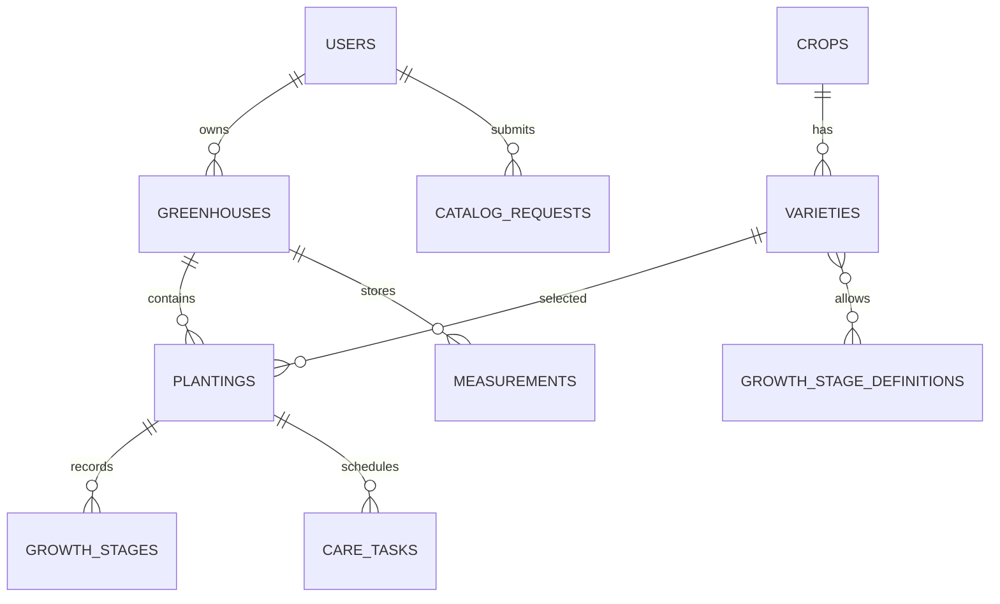

# Структура базы данных

Миграции являются единственным источником структуры БД. Первичные ключи используют `BIGINT UNSIGNED`, внешние ключи совпадают с ними по типу. Закрытые наборы значений хранятся как `ENUM`, температура и освещённость — как `DOUBLE`.
